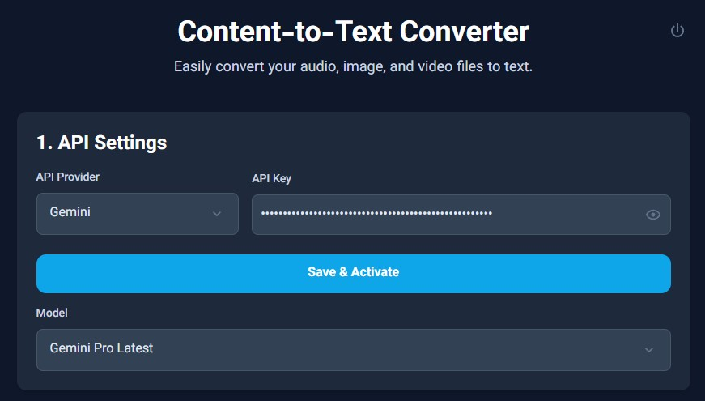
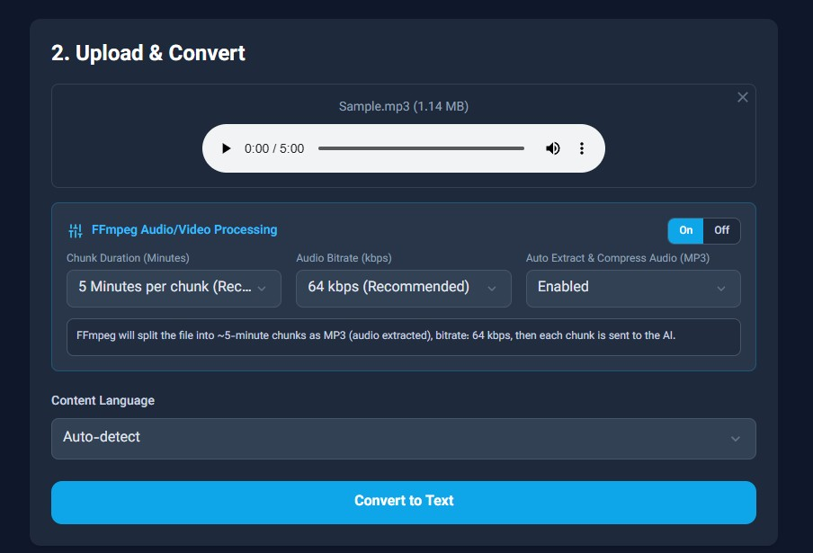
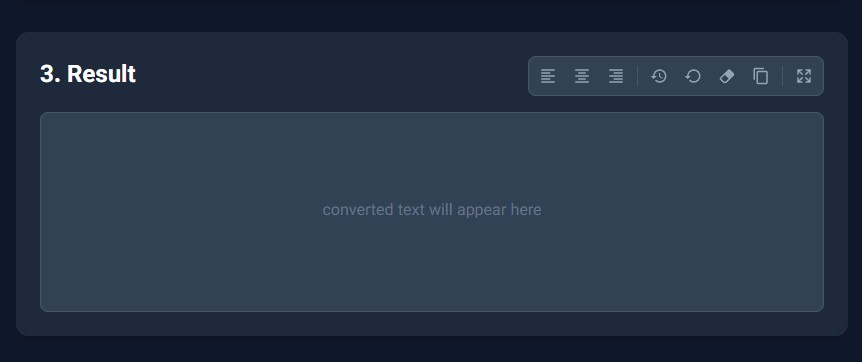
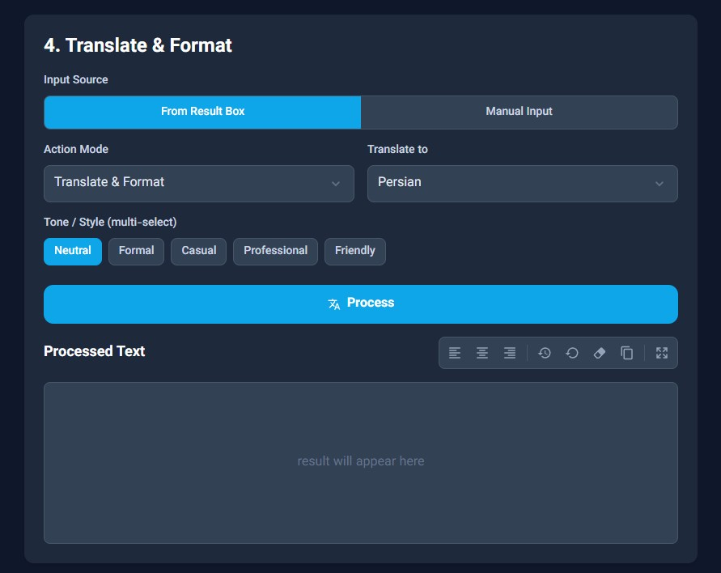

# 📑 Content-to-Text Converter

A modern, multilingual, browser-based tool for converting **audio**, **image**, and **video** files into text using AI-powered transcription, OCR, translation, and formatting — all running client-side with optional FFmpeg.wasm chunking for large media files.

<p align="center">
  
  
  
  
  <a href="./LICENSE">
    
  </a>
</p>

---

## 🚀 Getting Started

### Project Structure
```
index.html              # Main application (HTML + CSS + JS)
coi-serviceworker.js    # Required for SharedArrayBuffer / FFmpeg.wasm chunking
```

> **Important:** Both files must be served from the **same origin**.  
> Opening `index.html` directly via `file://` disables FFmpeg chunking because `SharedArrayBuffer` is unavailable without Cross-Origin Isolation.

### Running Locally (Recommended)

#### Option 1 — Python (built-in)
```bash
# From the project directory
python -m http.server 8000
# or
python3 -m http.server 8000
```
Then open: **http://localhost:8000/**

#### Option 2 — VS Code / Cursor (Live Server)
1. Install the **Live Server** extension.
2. Right-click `index.html` → **Open with Live Server**.
3. The page opens on a local HTTP port (usually `http://127.0.0.1:5500`).

#### Option 3 — Node.js
```bash
npx serve .
# or
npx http-server -p 8000
```
Then open the URL shown in the terminal (e.g. `http://localhost:8000`).

#### Option 4 — Any static file server
Any HTTP server that serves the two files from the same directory works (Nginx, Caddy, `php -S`, etc.).

### Why `coi-serviceworker.js` is required
FFmpeg.wasm needs `SharedArrayBuffer` for efficient audio/video chunking. Browsers only expose `SharedArrayBuffer` when the page is **Cross-Origin Isolated** (COOP + COEP headers).  

The included `coi-serviceworker.js` automatically injects these headers when the page is served over `http://` or `https://`. Without this file (or without a proper local server), chunking is disabled and large files are sent in one piece.

---

## 🖼️ Preview

| 1. API Settings | 2. Upload & Convert |
|:---:|:---:|
|  |  |

| 3. Result | 4. Translate & Format |
|:---:|:---:|
|  |  |

---

## 🌟 Core Features

### File Processing
- 🎵 **Audio Transcription** — Speech-to-text from audio files
- 🖼️ **Image OCR** — Extract text from images and screenshots
- 🎥 **Video Transcription** — Speech-to-text from video files
- 📦 **FFmpeg.wasm Chunking** — Split long audio/video into manageable chunks (3–15 min) with optional bitrate control
- 📁 **Wide Format Support** — MP3, WAV, OGG, M4A, FLAC, MP4, AVI, MOV, WEBM, MKV, PNG, JPG, WEBP, BMP, and more

### AI Integration
- 🤖 **Multiple Providers** — Google Gemini, OpenAI, Anthropic Claude
- 🎚️ **Auto Language Detection**
- 🔄 **Smart Retry** on API overload / rate limits
- 🔑 **Secure local storage** of API keys (never leave the browser)

### Translation & Formatting
- 🌐 **Multi-language Translation** — Persian, English, Arabic, Spanish, French, and more
- 📝 **Text Formatting** — Structure, paragraphs, and readability improvements
- 🎨 **Tone Variants** (when supported by the model)
- 📚 **Fully bilingual UI** — English / Persian with automatic RTL/LTR switching

### User Experience
- 🌓 **Dark / Light themes**
- 💫 **Modern glassmorphism UI** with subtle glow effects
- 📱 **Fully responsive**
- 📊 **Transcription & Translation History** with restore capability
- 📋 **Copy, Expand, Clear, and Reset** actions

---

## 🛠️ Technical Stack

| Layer | Technology |
|-------|------------|
| Frontend | Single-page Vanilla JS (ES6+) |
| Styling | Tailwind CSS (CDN) + custom dark/light themes |
| Icons | Iconify |
| Typography | Vazirmatn (Persian/Arabic optimized) |
| Media Processing | FFmpeg.wasm 0.11.x |
| Cross-Origin Isolation | coi-serviceworker.js |
| AI Providers | Gemini, OpenAI, Claude REST APIs |

### Supported APIs at a glance
| Provider | Audio | Image | Video | Notes |
|----------|-------|-------|-------|-------|
| **Gemini** | ✅ | ✅ | ✅ | Default, excellent multimodal |
| **OpenAI** | ✅ (Whisper) | ✅ | ✅ | Best pure audio quality |
| **Claude** | ❌ | ✅ | ❌ | Strong vision, no audio/video |

---

## 🎮 How to Use

1. **API Settings**  
   Choose provider → paste API key → **Save & Activate**.

2. **Upload & Convert**  
   Drag & drop or click to select a file.  
   Optionally enable FFmpeg chunking and set duration / bitrate.  
   Choose language (or leave Auto-detect) → **Convert to Text**.

3. **Result**  
   View the transcribed / extracted text.  
   Expand individual chunks if chunking was used.  
   Copy, clear, or save to history.

4. **Translate & Format**  
   Use the result as source (or paste custom text).  
   Choose mode: Translate & Format / Translate Only / Format Only.  
   Select target language → **Process**.

---

## 📋 Supported File Formats

**Audio:** MP3, WAV, OGG, M4A, FLAC  
**Video:** MP4, AVI, MOV, WEBM, MKV  
**Image:** PNG, JPG, JPEG, WEBP, BMP

---

## 🚦 Requirements

- Modern browser (Chrome 80+, Firefox 75+, Safari 13+, Edge 80+)
- Internet connection (for AI API calls)
- Valid API key from the chosen provider
- Local HTTP server (required for FFmpeg chunking)

---

## 🔧 Troubleshooting

| Issue | Solution |
|-------|----------|
| FFmpeg / Chunking unavailable | Make sure you are serving via `http://localhost` (or any HTTP server) **and** `coi-serviceworker.js` is present next to `index.html`. |
| API errors | Verify key validity, quota, and that the selected provider supports the file type. |
| Large file timeout | Enable chunking or use a shorter chunk duration / lower bitrate. |
| CORS / network errors | Ensure the page is not opened as `file://`. |
| UI language / direction | Toggle the language switcher in the header. |

---

## 📜 License [](LICENSE)

This project is licensed under the **MIT License**.

---

## 🙏 Credits

- [Tailwind CSS](https://tailwindcss.com) — utility-first styling
- [Iconify](https://iconify.design) — icon set
- [Vazirmatn](https://github.com/rastikerdar/vazirmatn) — Persian/Arabic typeface
- [FFmpeg.wasm](https://github.com/ffmpegwasm/ffmpeg.wasm) — in-browser media processing
- [coi-serviceworker](https://github.com/gzuidhof/coi-serviceworker) — Cross-Origin Isolation helper

---

> A complete, professional-grade content-to-text conversion suite packed into a lightweight static web app with client-side FFmpeg processing and multi-provider AI support.
